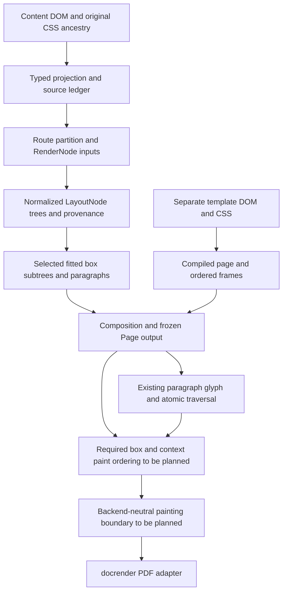

# CSS box-paint context through page layout

**Status:** Planning inventory, 28 November 2026. Follows
[REMARKS.md](REMARKS.md) and the agreed relaxation of painting within paragraphs.
Selected-box inspection is implemented; paint-order implementation and display-list
design remain open. Semantic text output remains deferred.

The boundary under discussion is selected box subtrees, stacking contexts and
box decoration relative to contained paragraph output. Paragraphs keep their
existing horizontal glyph/atomic traversal, settled positions and resolved colors.
CSS planning does not require a second logical ordering of their glyphs or a new
mapping from source elements to glyph ranges.

Most source ancestry and normalized box structure survive in private immutable
content snapshots. Published pages retain selected geometry, paint, paragraph
occurrences and template order. Selected box relationships are available through
the [inspection API](selected_box_subtree_api_proposal.md); the supported box/context
ordering policy remains to be defined.
Keeping the DOM alive is unnecessary.

`pagelayout` is the working owner of this required, encapsulated algorithm, outside
`docrender`. Its exact package placement remains open; no pluggable paint-order
interface is needed. See the [retained-data sketch](paint_context_data_sketch.md),
[box-subtree walkthrough](box_subtree_paint_walkthrough.md) and
[painter boundary inventory](pagelayout_painter_boundary_inventory.md).

## Actual pipeline

The CSS layout module is `css-box-layout`. Its `layout.RenderNode` is a detached
input to normalization, before `layout.LayoutNode`; it is not a later paint tree.

The final arrows describe responsibilities, not an execution schedule or retained
representation. Selected paragraph output and inline child subtrees meet at the
existing page/atomic composition boundary.

## What survives each boundary

| Boundary | Retained facts | Remaining boundary work |
| --- | --- | --- |
| Original DOM → styled source | Original ancestry/order, source identity, computed CSS and resolved text styles. | Resolve additional context-forming properties here if they are later admitted. No paint-context graph exists today. |
| Styled source → detached projection | Ordered `RenderNode` children, source IDs, display and typed box constraints; a separate ledger retains ancestry, typography, paint and routing. | The HTML descriptor is detached. Typed constraints contain no general stacking/effect model. |
| Routing → normalized trees | Independent residual/named-flow trees; ordered normalized children, box kinds, constraints and source-to-box provenance. | Original ancestry differs from layout ancestry. BoxID is not a sorting key; anonymous/split boxes require their actual structural relationships. |
| Normalization → content snapshot | Private trees, provenance, source ledger and paint; qualified Box handles keep the snapshot alive. | `Box.Info()` exposes individual facts. Fragment-scoped `SelectedBox` handles reuse this structure for selected children; a walk can carry its parent path. |
| Inline group → preparation | Completed paragraph inputs, foreground mapping, atomic box references and `ParentAtomic`. | Use existing paragraph painting. Ordinary inline background geometry is a separate deferred feature, not a reason to add glyph-level CSS associations. |
| Fitting → `FitFragment` | Selected geometry/used values, container fragment edges, paragraph occurrence IDs/origins and consumed atomic interiors. | `SelectedRoot`/`Selected` expose the selected hierarchy. `SelectedBox.Container` includes consumed interior containers absent from `Containers()`; child order remains structural, not paint order. |
| Template compilation → catalog | Page/frame paint and geometry, ordered frames and flow indexes. | State receiver paint scopes, content attachment and overflow behavior. DOM/CSSOM are deliberately released; fixed-frame status is implicit in the current profile. |
| Composition → frozen Page | Frame order, ordered branch-fragment placements, qualified box/paragraph identities and composed origins, including empty receivers. | Placement must be connected to the selected box/context structure without restyling content against the template. |
| Typography fragment → `FragmentResult` | Selected lines, positioned glyphs, fonts, resolved colors and physical atomic anchors. | Reuse this completed horizontal output. No source-to-glyph CSS ordering map or further semantic retention is required. |

Sources: [original styling](../../pagelayout/content/style.go),
[projection](../../pagelayout/content/project.go),
[routing](../../pagelayout/content/route.go),
[RenderNode](../../css-box-layout/layout/render.go),
[LayoutNode](../../css-box-layout/layout/box.go),
[normalization provenance](../../css-box-layout/layout/provenance.go),
[content snapshot](../../pagelayout/content/document.go),
[selected fragments](../../pagelayout/content/fit.go),
[template catalog](../../pagelayout/template/catalog.go),
[composition](../../pagelayout/content/compose.go),
[page output](../../pagelayout/page.go) and
[glyph result](../../typography/render/result.go).

## Box ancestry, coordinates and stacking contexts

Original source ancestry supplies CSS inheritance and provenance. Routing preserves
it separately from the normalized box trees. Receiving frames do not become new
CSS ancestors of the content.

Normalized box ancestry supplies structural relationships, including anonymous
wrappers. Coordinate parents specify placement. Neither `EstablishesBFC` nor
`LayoutGeometry.RelativeTo` establishes a stacking context. `BoxInfo.Context`
identifies source style context, not a paint parent. The artificial BFC wrappers
used during frame composition likewise provide geometric containment.

CSS painting groups boxes into stacking contexts and distinguishes decoration
from content phases. A context occupies one position in its parent's order;
stacking levels are compared within that context. An ordinary block subtree is
not automatically such a unit. These are the relevant algorithmic concerns.
[CSS layered presentation](https://www.w3.org/TR/CSS22/visuren.html#z-index)

The strict inline-order details of CSS are outside the agreed paragraph policy.
The box painter consumes completed paragraph material and reaches selected inline
box subtrees through existing atomic placement. It does not reorder glyphs by
source element, split ligatures or introduce per-glyph CSS scope ownership.

## Current profile and template attachment

The [content profile](../../pagelayout/content/profile.go) admits static normal
flow, flow-root and inline-block content. Floats, authored stacking levels,
opacity, transforms and clipping/overflow effects are outside that profile.
Their absent retained fields do not block the two-page spike. Resolved color
alpha remains distinct from element opacity.

The [template adapter](../../pagelayout/template/adapt.go) requires a static page
box and direct fixed frames. [Compilation](../../pagelayout/template/compile.go)
retains their order and rejects overlapping border rectangles. Nonoverlapping
allocation rectangles do not imply nonoverlapping ink or a clipping instruction.

The receiver contract still needs to define page/frame decoration, attachment of
content subtrees, receiver paint scopes and overflow behavior. Fixed frames and
their order are known from the profile/catalog; there is no need to retain all
template CSS. The separate template page and content body also need an explicit
background policy rather than an assumed browser canvas propagation rule.

Ordinary inline backgrounds are outside the current simple painting target.
Upstream loading can retain their colors without supplying per-line geometry;
that limitation remains documented. The spike's fixture should state its simple
accepted paint. Per-inline geometry and strict inline overlap conformance are
not new prerequisites for this work.

## Minimum facts to reuse or expose

| Fact | Existing authority | Planning requirement |
| --- | --- | --- |
| Selected box occurrences and structural order | `SelectedBox` combines the normalized snapshot and frozen fragment selection. | Use the selected view and keep page/frame context alongside it. No additional structure retention is needed for this inspection boundary. |
| Box roles and enclosing paint contexts | Normalized box kinds plus the admitted profile and receiver policy. | Derive current roles where possible; distinguish structural, coordinate and context ancestry. Retain additional stacking facts only when their features are admitted. |
| Decorations and fragment placement | Source paint, `FitContainer`, geometry and used values. | Use selected edges and include consumed atomic interior boxes. Exclude suffix material. |
| Contained paragraph output | `FitParagraph`, `FragmentID` and typed fragment inspection. | Associate completed paragraph occurrences with their owning boxes and resolved origins. Preserve existing horizontal paint behavior. |
| Inline child subtree attachment | `GroupInput.Occurrences`, `ParentAtomic` and retained atomic anchors. | Join each selected atomic to its box subtree once, qualified by parent paragraph occurrence. Use one composition path. |
| Page and receiver structure | Page/frame descriptors and composed fragment order. | Define the shared box/context attachment and overflow policy. Keep empty decorated receivers. |

Box handles already retain the complete immutable snapshot. New exposure does not
require a fitter or preparation session. It also does not remove source text
already held privately in that snapshot; semantic export remains deferred.

If broader CSS effects are admitted later, resolve context triggers and stacking
levels in original ancestry before discarding styling, then preserve their box
relationships through routing and fragmentation. This is a future extension,
not a placeholder effect model required by the spike.

## Responsibilities and remaining planning work

- `w3c-dom` resolves admitted CSS in original ancestry.
- `css-box-layout` supplies normalized structure, provenance and selected geometry.
- `pagelayout/content` retains those facts and provides immutable selected-box access.
- The existing typography adapter connects contained paragraph output and selected
  atomic interiors without introducing typography dependencies into root/content/template.
- `pagelayout` manages the supported box/context ordering policy. The bridge composes
  selected occurrences; `docrender` owns backend resources and serialization.

The next planning examples concern box decoration around paragraph contents,
selected inline-block subtrees, continuing containers and receiver attachment.
Stacking-context examples explain the future `z-index` boundary without making
that feature a spike requirement. RTL, marks, ligatures and replacements remain
existing typography regressions, not new CSS paint-association requirements.
